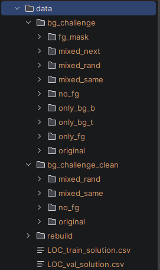
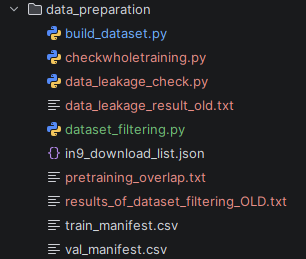
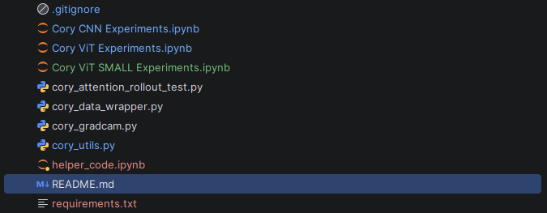
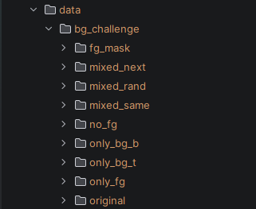

# Cory AIML339 Project: Background Reliance in CNN and ViT Image Classifiers

**This project compares how much ResNet-50 and ViT-B/16 rely on image backgrounds when classifying objects, and tests whether background randomisation augmentation can reduce that reliance (if any exists).
Both models are fine-tuned on a 9 class subset of ImageNet (IN-9) and evaluated on a large subset of Backgrounds Challenge test variants from the github page https://github.com/MadryLab/backgrounds_challenge**

The dataset I used can be distributed only to the teaching team if needed, as the raw dataset is 100GB+.

A smaller ViT-S/16 model was trained on the same dataset, which has a much closer parameter count to the ResNet-50, it also was decided to be used to check whether model size would contribute to background reliance.

(Note: Unfortunately, I misclicked on the stop kernel button and deleted all the printouts from each cell in the ViT notebook, this applied only to the main ViT-B/16, and the results can still be viewed inside of the runs_10_epochs folder)
(Note: Figures containing ImageNet or backgrounds challenge are not included, per the imagenet terms)
---
# **Project Files**
### **Data/**
- Contains all the data that will be used in this project (Made upon completing the inital data processing files)
- (rebuild/ the folder with training and val)
- (bg_challenge_clean/: the folder with all test images)
- LOC_train_solution.csv, LOC_val_solutions.csv: The image IDs and the corresponding bounding boxes

- 
### **Data_preparation/** 
- Contains the code used to build and filter the dataset from scratch. (`build_dataset.py`,)
- Contains the train_manifest file for the dataset, which has all the ids for the images used in the training data. (`train_manifest.csv`,)
- Contains the val_manifest file for the dataset, which has all the ids for the images used in the validation data. (`val_manifest.csv`,)
- Contains checkwholetraining.py, which compares every validation and test photo with all 1,281,167 ImageNet-1k training images (the data the models were pretrained on) and prints the near-duplicates, which are saved to pretraining_overlap.txt. (`checkwholetraining.py`,)
- Contains pretraining_overlap.txt which has the files that will be filtered out of the test or validation set to prevent data leakage. (`pretraining_overlap.txt`,)
- data_leakage_check is the original file to check for data leakage from the test set in the used training set (this was depricated as it only checked the used training set instead of the entire possible training data). (`data_leakage_check (Depricated).py`,)
- `data_leakage_result (Depricated).txt` and `results_of_dataset_filtering_OLD.txt` are outputs from the earlier, superseded leakage check and are kept only for reference.

### Project Root
- Contains the utilities files used in the experiments for both CNN and ViT (`cory_utils.py`)
- Contains the code for getting and setting up the files for the data (i.e. getting the bounding boxes) (`cory_data_wrapper.py`)
- Contains the code for creating the visual explanations of the model predictions i.e. heatmaps (`cory_gradcam.py` and `cory_attention_rollout_test.py`)
- Contains the code for the training and evaluation of the models (`Cory CNN Experiments.ipynb`, `Cory ViT Experiments.ipynb`,`Cory ViT SMALL Experiments.ipynb` )
- Contains the code for main results reported in the final report (`helper_code.ipynb`)

---
# Dependencies
install a CUDA version of pytorch  
The rest can be installed with:
pip install -r requirements.txt
- grad-cam
- numpy
- pandas
- pillow
- tensorboard
- timm
- torch
- torchvision
- opencv
- ipykernel
- matplotlib
- scipy

---
# Dataset Preparation
The datasets are not in this repository as:
- They contain sensitive information (i.e. scraped pictures of people)
- Imagenet does not allow redistribution of the data

Files needed:

`ILSVRC.zip`
from the Kaggle ImageNet Object Localization Challenge, this does not need to be unzipped and can be directly read. (For Training and Validation Images) 

(Note the size is ~150GB)
- https://www.kaggle.com/competitions/imagenet-object-localization-challenge/data?select=ILSVRC

---
The Following LOC files should be put inside the root of the data/folder.

`LOC_train_solution.csv`
- https://www.kaggle.com/competitions/imagenet-object-localization-challenge/data?select=LOC_train_solution.csv

`LOC_val_solutions.csv:`
- https://www.kaggle.com/competitions/imagenet-object-localization-challenge/data?select=LOC_val_solution.csv

---
`backgrounds_challenge_data.tar.gz` Test_Data (267MB): 
- https://github.com/MadryLab/backgrounds_challenge/releases

The Backgrounds Challenge Test Data should be extracted and put inside the root of the data/ folder:

---
# Script Order
| Step | Script                  | What it does                                                                                                                                                                                                                                                                                                                                                                                                                                                                     | Result |
|---|-------------------------|----------------------------------------------------------------------------------------------------------------------------------------------------------------------------------------------------------------------------------------------------------------------------------------------------------------------------------------------------------------------------------------------------------------------------------------------------------------------------------|---|
| 1 | `build_dataset.py`      | Builds the training and validation sets from the zip (set `ZIP_PATH` at the top first). It uses the class mapping in `in9_download_list.json` (370 ImageNet categories filtered into 9 classes), keeps only training images that have a bounding box, leaves out every validation image the Backgrounds Challenge uses, and balances every class to the size of the smallest one with seed 0. The exact files chosen are written to `train_manifest.csv` and `val_manifest.csv`. | `data/rebuild/in9_train`: 72,036 images (8,004 per class). `data/rebuild/in9_val`: 1,935 images (215 per class) |
| 2 | `checkwholetraining.py` | Scans all ImageNet-1k training images in the zip (set `ZIP_PATH` at the top first) for near-duplicates of the validation and test photos, because both models were pretrained on ImageNet-1k. It deletes nothing. **Copy the console output by hand into a new .txt file in this path: `data_preparation/pretraining_overlap.txt`**                                                                                                                                              | `pretraining_overlap.txt` |
| 3 | `dataset_filtering.py`  | Reads `pretraining_overlap.txt`, removes the flagged photos from the validation set, and copies the four test variants into `data/bg_challenge_clean` without the flagged photos, keeping the variants paired. The original test files are never changed.                                                                                                                                                                                                                        | Validation: 1,886 images. Clean test set: 3,889 images per variant (161 object photos left out of 4,050) |

`train_manifest.csv`,`val_manifest.csv` list the exact images used for training and validation.

`pretraining_overlap.txt`, is the output of step 2, so it can be skipped when reading if needed as step 3 reads this file directly.

The balancing step uses a fixed random seed and sorted file list, so the same ImageNet zip and the same mapping give the same selection each time.

---
# Training

Either `Cory CNN Experiments.ipynb`, `Cory ViT Experiments.ipynb` or `Cory ViT SMALL Experiments.ipynb` can be run first to train the models.
They are set up to run sequentially so run all is good enough to train all models.

Learning rate search: the search trains on the original images (seed 0) for each learning rate in (2.5e-05, 5e-05, 1e-04) for up to 10 epochs with early stopping (patience 3). The learning rate with the highest validation accuracy is chosen. The chosen rates are already filled into BEST_LR in each notebook, so the search is skipped when running all cells; set a value to None to rerun it.

Each cell runs its respective call, run_cnn_experiment or run_vit_experiment, for one seed and one condition. They were separated into individual cells so the results are easy to read from the verbose output.

The run trains the model, saves the weights into the results_10_epochs folder, evaluates the model on each test variant and adds its result to the respective {model}_results.json.

Trained weights are not included (they are large and derived from ImageNet), so helper cell 9 and the heatmap cells need the experiment notebooks to be run first. Helper cells 1 and 2 need the dataset from the data preparation steps, and every other helper cell runs from the results and TensorBoard logs in this repository.

To retrain from scratch, rename or delete results_10_epochs/ and runs_10_epochs/ first so the new runs do not mix with the included ones.

The two conditions use the same images, settings and seeds. Only the training data is different.
- Original: augmentation_strength = 0.0, the training images are unchanged.
- Augmented: augmentation_strength = 1.0, the background of every training image is replaced each time it is loaded. The object is cut out with GrabCut inside its bounding box (falling back to the bounding box if the GrabCut mask is smaller than 2% of the image).
- Validation always uses the original images for both conditions.

Seeds are set for each run, but GPU training is not bit-for-bit deterministic, so a rerun with the same seed may not give identical results (but it should be very close).

---
# Evaluation
At the end of every run the model is evaluated on four background challenge test variants. and three reliance measures are computed:
- Original accuracy: The accuracy of the model on the original test images.
- No-FG Accuracy: Accuracy when the object is removed. Chance is 11% (1/9), an accuracy above that shows how much the model can classify from background alone
- BG-Gap Accuracy: Accuracy difference between Mixed-Same and Mixed-Random, which shows how much the prediction changes when the background comes from a different class.
---
- TEST_INSTANCES is the constant that defines the test set, bg_challenge is the full test set, however it has overlapping images with the training set, so checkwholetraining.py finds the near-duplicates and dataset_filtering.py removes them to make bg_challenge_clean.
- The summary cell averages the saved results over seeds.
- The inference time counter is used to calculate the inference time and peak GPU memory on random input with a batch of 32.
---

### Per-class results (Table IV, Section V-C)
The per-class cell in `helper_code.ipynb` loads each saved model, evaluates it class by class on the cleaned Original, Mixed-Same and Mixed-Rand variants, and writes:
- `results_10_epochs/per_class_accuracy.csv`: accuracy per model, condition, seed, variant and class
- `results_10_epochs/per_class_summary.csv`: per-class mean and SD over the ten seeds of Original accuracy, Mixed-Rand accuracy and BG-Gap

### Heatmaps (Fig. 3)
The Grad-CAM cell in `Cory CNN Experiments.ipynb` and the attention rollout cells in both ViT notebooks generate the heatmaps for Mixed-Rand test image index 1023 with the seed-0 weights. The images are saved to `figures_10_epochs/`, which is not included in this repository.

# **Configurations for the Main Results**

| Setting | ResNet-50                                                                    | ViT-B/16                                | ViT-S/16                                 |
|---|------------------------------------------------------------------------------|-----------------------------------------|------------------------------------------|
| Pretrained weights | torchvision `IMAGENET1K_V2`                                                  | timm `vit_base_patch16_224.augreg_in1k` | timm `vit_small_patch16_224.augreg_in1k` |
| Input normalisation | ImageNet Mean and STD: (Mean: 0.485, 0.456, 0.406), (STD:0.229, 0.224,0.225) | (0.5, 0.5, 0.5)                         | (0.5, 0.5, 0.5)                          |
| Learning rate (from the search) | 2.5e-5                                                                       | 2.5e-5                                  | 2.5e-05                                  |
| Seeds | 0, 339, 1, 2, 3, 4, 5, 6, 7, 8                                               | 0, 339, 1, 2, 3, 4, 5, 6, 7, 8          | 0, 339, 1, 2, 3, 4, 5, 6, 7, 8           |
| Conditions | original, augmented                                                          | original, augmented                     | original, augmented                      |

Settings: 
- Image Size: 224x224
- Batch Size: 32
- Optimiser: AdamW, weight decay 0.01
- Warmup: 10% linear warmup with cosine decay
- Gradient Clipping: norm 1.0
- Epochs: up to 10
- Early Stopping: 3 on Validation Accuracy

